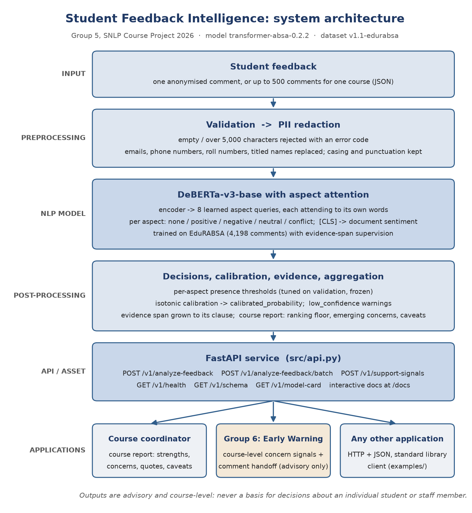

# Student Feedback Intelligence — Final Report

*SNLP Course Project 2026 · Group 5 · E029 · E030 · E031 · E033 · E034 · E035*

## 1.  Problem Statement

Universities collect large amounts of written student feedback, but faculty usually receive only the average numerical rating. An average says *that* students are unhappy, not *with what*. Take one comment: “The lectures were very informative, but the pace was too fast and the assignments were difficult.” It praises one part of the course and criticises two others. A single positive or negative label cannot represent it, and a coordinator cannot act on one.

We built a reusable NLP service that reads a comment and returns, for each part of the course it discusses, the **aspect**, the student's **polarity** towards it, the **evidence words**, and a **calibrated confidence**. For a whole course it returns a report of top strengths, top concerns, emerging concerns and verbatim quotes. For the example above it returns *teaching: positive*, *pace: negative* and *assessment: negative*.

## 2.  Institutional Context

| User | What they get | Endpoint |
|---|---|---|
| Course coordinator | A course report: what students praise, what they criticise, with quotes | `POST /v1/analyze-feedback/batch` |
| Faculty member | Which aspects of their own course drew criticism, with the student's words | `POST /v1/analyze-feedback` |
| Department head | Workload and pace concerns across a course | batch report, `emerging_concerns` |
| Group 6: Early Warning | Course-level concern signals for student-support triage | `POST /v1/support-signals` |
| Any other application | Structured JSON over HTTP, documented, with a model card | all of the above |

The output is advisory and course-level by design. It is never used to make a decision about an individual student or staff member (Section 14).

## 3.  Existing Approaches

**Research.** Aspect-based sentiment analysis (ABSA) began with product reviews. Hu and Liu (2004) mined the product features customers mention and the polarity of each opinion sentence, using frequent nouns and an opinion-word lexicon. SemEval-2014 Task 4 (Pontiki et al., 2014) standardised the task, including *aspect-category* sentiment with the four polarities we use (positive, negative, neutral, conflict). Neural models then let each aspect focus on its own words, through attention-based LSTMs (Wang et al., 2016) and through BERT fine-tuned with an auxiliary sentence per aspect (Sun, Huang and Qiu, 2019).

In education, a systematic mapping study of 92 papers on student-feedback sentiment found a shift from lexicon and dictionary methods, dominant until about 2016–2017, towards deep learning (Kastrati et al., 2021). Sindhu et al. (2019) applied a two-layer LSTM to aspect-based analysis of student feedback for faculty evaluation. Kastrati, Imran and Kurti (2020) used weak supervision to label aspects in about 105,000 Coursera MOOC reviews. Most such work uses either document-level labels or small in-house datasets. EduRABSA (Hua et al., 2025) is the first public, expert-annotated ABSA dataset of course and teacher reviews, and it is the dataset we use.

**Products.** Survey platforms already analyse open comments. Qualtrics Text iQ tags responses with topics, assigns sentiment per response and per topic, and reports them in dashboards. Explorance MLY is built for course evaluations: it sorts comments into student-experience themes, scores their sentiment and can redact sensitive comments. Universities including UWE Bristol and Heriot-Watt have adopted it. Both are closed, paid products. Neither publishes accuracy figures for its sentiment or topic labels.

**What we add.** A model that is open and measured: one fine-tuned model for the joint (aspect, polarity) decision, evaluated on a frozen public test split against a baseline with confidence intervals. Every judgement carries evidence words and a calibrated score. Course-level outputs carry responsible-use flags and are designed for reuse by other components of the AI University.

## 4.  NLP Formulation

| Task | Output | Type | Metric |
|---|---|---|---|
| A. Document sentiment | positive / neutral / negative | 3-class | accuracy, macro-F1 |
| B. Aspect detection | which of 8 aspects are discussed | multi-label | micro-F1 |
| **C. ABSA (core)** | set of (aspect, polarity) pairs | structured prediction | **exact-match micro tuple-F1** |

The 8 aspects are teaching, faculty_interaction, course_content, pace, assessment, workload, resources and other. The 4 polarities are positive, negative, neutral and conflict (both views about one aspect). A predicted pair counts only if both its aspect and its polarity are right. This is stricter than reporting aspect F1 and polarity accuracy separately, which would hide “right aspect, wrong feeling”. Topic clustering, listed among the handout's techniques, was descoped (Section 15).

## 5.  Dataset

| Item | Value |
|---|---|
| Source and licence | EduRABSA (Hua et al., 2025), Zenodo doi 10.5281/zenodo.16935017; CC BY-NC-SA 4.0 |
| Comments used | 5,998: 2,998 University of Waterloo course reviews and 3,000 RateMyProfessor teacher reviews. The 500 university-wide reviews and 2 unlabelled ones are excluded |
| Labels | Expert quadruplets (aspect term, opinion term, category, sentiment), mapped from 24 categories to our 8 by written rules (`src/build_dataset.py`) |
| Aspect annotations | 11,271 (comment, aspect) pairs; 1.88 per comment; 466 comments (7.8%) carry no aspect |
| Polarity distribution | positive 52.2%, negative 30.5%, conflict 9.3%, neutral 8.0% |
| Split | 4,198 / 900 / 900 (70/15/15), iterative stratification, near-duplicates grouped, seed 42, frozen in `data/processed/splits.json` |
| Version | v1.1-edurabsa: lecture comments mapped to `teaching` (Rule 2b, 221 comments relabelled on the same frozen split) |

**Why this data.** The original plan was team-written comments. It was rejected because a model trained and scored on text written and labelled by the same six people learns their phrasing, not the task. **Quality issues** were measured and handled: 15 exact duplicates and 16 near-duplicate groups (kept in one split each), a 22.6 : 1 imbalance between the largest and smallest aspect (teaching against pace), and no code-switched text. **Privacy:** the reviews are public and contain no student identifiers, but teacher reviews name instructors. Names are redacted at model input when preceded by a title. **Pace** has no source category; it is derived by a keyword-plus-category rule, with every one of the 151 moved labels listed for audit.

## 6.  Preprocessing

| Step | Baseline branch (TF-IDF) | Transformer branch |
|---|---|---|
| PII redaction (emails, phones, roll numbers, titled names) | yes | yes |
| Whitespace normalisation | yes | yes |
| Lowercasing, punctuation removal, contraction expansion | yes | no: casing and punctuation are signal for the model |
| Negation scope marking (`NOT_` prefix to the clause end) | yes | no: attention handles negation |
| Stopwords | removed, except negation and contrast words | kept |
| Tokenisation | word 1–2 grams + character 3–5 grams | DeBERTa-v3 sub-words, max 256 tokens |

The original text is always kept, because evidence spans are reported as offsets into what the user actually sent.

## 7.  Baseline

TF-IDF features (word and character n-grams) with logistic regression, in two stages. Stage 1 detects aspects with a one-vs-rest classifier. Stage 2 is one shared polarity classifier, given the comment plus the aspect as an extra token. A keyword lexicon built from the training split only served as a second, fully transparent baseline. On the test split the baseline reaches tuple-F1 **0.452** [0.427, 0.476], against 0.216 for always predicting the most common pair (Section 11). Its error analysis set the agenda for the improved model. Its largest single error type (11 of 40 sampled errors) was copying one overall tone onto every aspect of a mixed review, because Stage 2 reads the whole comment.

## 8.  Proposed Method

**DeBERTa-v3-base with aspect-specific attention** (He, Gao and Chen, 2021). The encoder produces a vector for every token. Eight learned *aspect queries* each attend over those vectors, so `teaching` can read “lectures were informative” while `pace` reads “too fast”. Each aspect has its own 5-way head (none, positive, negative, neutral, conflict), so detection and polarity are one decision, trained directly on the pair we are scored on. A document-sentiment head on `[CLS]` comes from the same pass. **Evidence supervision:** where EduRABSA marks the words behind a label, an extra loss term rewards that aspect's attention for landing on them (weight 0.5).

Training used 4,198 comments for 6 epochs, keeping the best epoch on validation. Two problems had to be solved to train on a 4 GB laptop GPU (RTX 3050):

- Transformers 5 loads DeBERTa-v3 in fp16, which made training diverge to NaN, so the weights are forced to fp32.
- The 98M-parameter embedding table is frozen to save memory.

On top of the model, all choices were made on validation only and then frozen:

- **Pipeline v1.1:** per-aspect presence thresholds; evidence spans grown from the attention peak to the surrounding clause, capped at 8 words; and a ranking floor for course reports (3 mentions and 5% of comments).
- **Isotonic calibration** of the three scores (Zadrozny and Elkan, 2002).
- **Emerging concerns:** aspects below the ranking floor but clearly negative.

**Comparison model.** Frozen MiniLM sentence embeddings with logistic regression (Reimers and Gurevych, 2019). This is the handout's “TF-IDF → sentence transformer” step. It tests whether pretraining alone explains the gain.

## 9.  Architecture



A request passes through validation and redaction, then the model, then the frozen decision layer, calibration and span extraction. Single comments return per-aspect JSON. Batches are aggregated into a course report or into Group 6 signals. `src/pipeline.py` holds all NLP; `src/api.py` only adds HTTP, validation and error codes, so the Python module and the web API always return identical results.

## 10.  Experiments

- **Test-split discipline.** The 900 test comments were never used to choose anything. Every setting was frozen on validation, with a SHA-256 fingerprint that the test script checks, and every opening of the test split is logged (`results/test_openings.log`).
- **Uncertainty.** 95% bootstrap confidence intervals (1,000 resamples) on every test figure. Model differences use a *paired* bootstrap over the same comments.
- **Systems compared.** Majority-class and stratified-random references; the lexicon baseline; the TF-IDF baseline; MiniLM embeddings (with and without tuned thresholds); and DeBERTa v1 and v1.1.
- **Further checks.** Training stability over 3 seeds; an ablation without evidence supervision; per-aspect results; error slices; robustness to typos, lowercasing and missing punctuation; 32 hand-written behaviour probes in the CheckList style (Ribeiro et al., 2020); and calibration error (ECE).

## 11.  Results

All figures are on the 900-comment test split, dataset v1.1 (`results/week4_d1.1_test_eval.json`, `results/week5_eval.json`).

| System | Tuple-F1 | 95% CI | Precision | Recall | Polarity acc. on found aspects |
|---|---|---|---|---|---|
| Stratified random | 0.147 | [0.130, 0.165] | 0.149 | 0.144 | 0.413 |
| Majority class | 0.216 | [0.196, 0.238] | 0.310 | 0.166 | 0.567 |
| Lexicon + LogReg | 0.332 | [0.307, 0.356] | 0.379 | 0.296 | 0.625 |
| **TF-IDF + LogReg (baseline)** | **0.452** | [0.427, 0.476] | 0.432 | 0.472 | 0.612 |
| MiniLM embeddings, tuned | 0.500 | [0.476, 0.523] | 0.527 | 0.475 | 0.699 |
| **DeBERTa aspect attention v1.1 (the asset)** | **0.704** | [0.683, 0.723] | 0.699 | 0.708 | 0.822 |

| Paired comparison (same 900 comments) | Difference | 95% CI |
|---|---|---|
| Asset − TF-IDF baseline | **+0.252** | [+0.225, +0.279] |
| MiniLM (tuned) − TF-IDF baseline | +0.048 | [+0.024, +0.075] |
| Asset − MiniLM (tuned) | +0.204 | [+0.180, +0.228] |
| v1.1 decisions − v1 | −0.001 | [−0.006, +0.004] |

**Findings.**

1. **The improved model wins clearly**, and both halves of the task improve: aspect detection micro-F1 is 0.856, and polarity accuracy on correctly found aspects rises from 0.612 to 0.822.
2. **Pretraining alone is not the reason.** Frozen sentence embeddings add only +0.048, so most of the gain comes from fine-tuning with per-aspect attention.
3. **Evidence supervision helped.** Removing it cost 0.033 on test (dataset v1.0).
4. **Threshold tuning made no measurable difference**, and it is reported as such.

Training is stable: 3 seeds score 0.712 ± 0.002 on validation.

| Aspect | Support | Tuple-F1 | Aspect | Support | Tuple-F1 |
|---|---|---|---|---|---|
| teaching | 492 | 0.802 | pace | 21 | 0.649 |
| faculty_interaction | 237 | 0.798 | workload | 78 | 0.627 |
| assessment | 227 | 0.671 | other | 122 | 0.540 |
| course_content | 408 | 0.651 | resources | 100 | 0.487 |

**Document sentiment:** accuracy 0.859 and macro-F1 0.831, against 0.750 / 0.722 for TF-IDF.

**Calibration (ECE, before → after):** aspect 0.030 → 0.008, polarity 0.050 → 0.026, document 0.116 → 0.021 (`results/week5_calibration.json`).

**Robustness (tuple-F1):** 0.678 with typos, 0.700 all lowercase, and 0.692 with no punctuation.

**Evidence spans:** 55% closely match the human-marked words, up from 12% before the clause rule.

**Speed:**
- 23 ms per comment on the training laptop's GPU (RTX 3050);
- 45 ms mean per HTTP round trip on that GPU;
- 216 ms mean (median 206 ms) on the CPU of the laptop used for the final demo, with no GPU (`results/week8_cpu_latency.json`).

## 12.  Error Analysis

494 of the 900 test comments contain at least one error, but the typical error is a single slip: 311 of them have exactly one aspect wrong. A random sample of 40 errors was coded by hand (`results/week5_errors_coded.json`):

| Cause | Of 40 |
|---|---|
| boundary between neighbouring categories | 16 |
| mixed (conflict) opinion flattened | 8 |
| neutral read as positive or negative | 5 |
| model right, gold label missing | 4 |
| minor aspect missed in a long review | 4 |
| implicit aspect | 2 |
| sarcasm | 1 |

The baseline's dominant error, one tone copied across aspects, is gone.

| # | Comment (shortened) | Gold | Predicted | Why it failed |
|---|---|---|---|---|
| 1 | “She has said some nice things about my style of writing … she knows that she is disorganized …” | teaching: conflict | teaching: positive | Mixed opinion; conflict is recognised in only 56 of 148 cases |
| 2 | “This is an interesting course with lots of content. It isn't too difficult …” | course_content: neutral | positive | Neutral is the weakest polarity (31 of 116 right) |
| 3 | “The professor assigns a BOAT LOAD of readings that it becomes unbearable …” | workload: negative | assessment: negative | Quantity of work against nature of the task: the hardest boundary |
| 4 | “… when asking for help she explains it with you step by step one on one.” | faculty_interaction: positive | teaching: positive | “Explains” is a strong teaching cue; the context says availability |
| 5 | “… He cherry picked the class on who he wanted to teach things to …” | faculty_interaction: negative | (missed) | Implicit aspect: no word names it |
| 6 | “This course is a neglected middle child who bothers you every 2 weeks.” | resources: conflict | three spurious aspects | Figurative language |
| 7 | Probe: “The exams were not fair.” | assessment: negative | + teaching: negative | Learned bias: negativity attributed to the teacher (5 of the 15 failed probes) |
| 8 | Probe: “Oh great, another surprise quiz on Monday.” | assessment: negative | (nothing) | Sarcasm read literally; sarcasm probes pass 0 of 4 |
| 9 | Probe: “Sir ka padhane ka tareeka bahut accha hai.” | teaching: positive | (nothing) | Hinglish is absent from the training data; 0 of 5 pass |

**Slices** show where errors concentrate:

- reviews over 80 words: 0.611;
- course reviews against teacher reviews: 0.635 against 0.759;
- comments containing *but / however / although*: 0.652.

Behaviour probes pass 17 of 32: short form-style comments 6/6, contrast 5/6, negation 4/6, implicit aspects 2/5, sarcasm 0/4 and Hinglish 0/5.

## 13.  Reusability

The handout's reusable-asset test (§21) is answered at the top of `README.md`. In short:

- **Input:** one anonymised comment, or up to 500 comments for a course, as JSON.
- **Output:** aspects, polarity, calibrated scores and evidence per comment; a course report per batch.
- **Interface:** six HTTP endpoints. Typed schemas generate interactive documentation at `/docs`, and errors use one documented format.
- **Documentation and examples:** `docs/API.md` (practical guide), `docs/API_Specification.md` (contract v2.2) and `examples/client_example.py` (standard library only). `GET /v1/model-card` returns measured accuracy and known failure modes, so a consumer can judge fitness first.

**Integration with Group 6 (Early Warning).** The handout names Group 5 → Group 6 as an integration point (§22), and it works in both directions:

- **Signals we send.** `POST /v1/support-signals` sends course-level `academic_concern` signals, one per top or emerging concern. Each carries `advisory_only` and `not_for_individual_action` and contains no comment or id. On the 150-comment demo course it signals workload (12 negative mentions of 150) and pace (3, emerging) (`results/week7_support_signals_demo.txt`).
- **Comments in their format.** At Group 6's request we built 38 comments in their format (`src/integration_group6.py`): 30 from the training split and 8 hand-written ones marked synthetic. Any comment that might name a person is excluded.
- **Reading their reply.** The `merge` step reads their reply back as counts only.
- **Status.** Group 6's reply had not reached us when this report was written. The handoff is shown with a keyword stand-in, labelled MOCK in every output: 38 of 38 ids read back, with no unknown or missing id (`results/week7_group6_merge_mock.json`). That checks our plumbing, not Group 6's system.

## 14.  Responsible AI

The one-page statement is `docs/Responsible_AI_Statement.pdf`. Its main points:

- **Privacy.** Public, licensed data. The model runs locally, and no text is sent to an external AI service. Emails, phones, roll numbers and titled names are redacted, more strictly still in report quotes. Names *without* a title are not caught, which is why the Group 6 sample excludes any comment that may contain one.
- **Bias.** The model attributes negativity to the teacher: in 5 of 15 failed probes it adds a spurious *teaching: negative*, which is unfair to instructors. Hinglish and sarcasm fail completely. The training data are North American and UK reviews. Instructor ranking is therefore out of scope, and the asset is declared English-only.
- **Hallucination.** The model is extractive: labels come from fixed lists, evidence is a span of the input, and report quotes are verbatim sentences. Nothing is generated.
- **Explainability.** Every judgement shows the words that drove it, and the model card lists known failure modes.
- **Security.** Input is validated; feedback text is untrusted and must not be pasted unescaped into an LLM prompt.
- **Human oversight.** Calibrated scores; `low_confidence` warnings; an instability caveat under 20 comments; flags forbidding individual action. A coordinator reads the quotes behind every concern.

## 15.  Limitations

- **Neutral and conflict opinions** are the main weakness: only 31 of 116 neutral and 56 of 148 conflict opinions are recognised.
- **Sarcasm, Hinglish and implicit aspects** fail, and very long reviews score lower (0.611).
- **One data source.** Every number comes from public review sites. Accuracy on NMIMS feedback forms is untested.
- **Label mapping.** EduRABSA has a single expert annotator, and our 24 → 8 mapping was not checked by an inter-annotator agreement round. Pace has only 21 test comments, so its figure is the least reliable (CI [0.428, 0.818]).
- **Bare-name redaction** is missing.
- **Descoped items:** topic clustering (the handout's “topic coherence or cluster quality”) and a graphical user interface were planned but not built. The interactive `/docs` page and the terminal demos serve as the interface.
- **Group 6 integration** has been exercised only against a stand-in so far.

## 16.  Future Work

For a production system:

1. **Domain data.** A few hundred labelled NMIMS comments, including Hinglish, for evaluation and fine-tuning, with an agreement round before use.
2. **Named-entity redaction** before any real feedback is processed, with an audit log.
3. **Polarity granularity.** A class-weighted loss or more mixed-opinion examples for neutral and conflict, and a bias probe set run before every release.
4. **Engineering.** Authentication, rate limits, a GPU or quantised CPU deployment, model versioning, and monitoring for drift.
5. **The handout's stretch goal.** Comparison across semesters, courses and departments.
6. **Group 6.** Agree their reply format, add a live endpoint, and evaluate the joint pipeline on labelled cases.

## References

- He, P., Gao, J. and Chen, W. (2021). DeBERTaV3: Improving DeBERTa using ELECTRA-Style Pre-Training with Gradient-Disentangled Embedding Sharing. arXiv:2111.09543.
- Hu, M. and Liu, B. (2004). Mining and Summarizing Customer Reviews. Proceedings of KDD 2004, pp. 168–177.
- Hua, Y., Denny, P., Wicker, J. and Taskova, K. (2025). EduRABSA: An Education Review Dataset for Aspect-based Sentiment Analysis Tasks. arXiv:2508.17008.
- Kastrati, Z., Dalipi, F., Imran, A. S., Pireva, K. and Wani, M. A. (2021). Sentiment Analysis of Students' Feedback with NLP and Deep Learning: A Systematic Mapping Study. Applied Sciences 11(9), 3986.
- Kastrati, Z., Imran, A. S. and Kurti, A. (2020). Weakly Supervised Framework for Aspect-Based Sentiment Analysis on Students' Reviews of MOOCs. IEEE Access 8, pp. 106799–106810.
- Pontiki, M. et al. (2014). SemEval-2014 Task 4: Aspect Based Sentiment Analysis. Proceedings of SemEval-2014.
- Reimers, N. and Gurevych, I. (2019). Sentence-BERT: Sentence Embeddings using Siamese BERT-Networks. EMNLP-IJCNLP 2019.
- Ribeiro, M. T., Wu, T., Guestrin, C. and Singh, S. (2020). Beyond Accuracy: Behavioral Testing of NLP Models with CheckList. ACL 2020.
- Sindhu, I., Daudpota, S. M., Badar, K., Bakhtyar, M., Baber, J. and Nurunnabi, M. (2019). Aspect-Based Opinion Mining on Student's Feedback for Faculty Teaching Performance Evaluation. IEEE Access 7, pp. 108729–108741.
- Sun, C., Huang, L. and Qiu, X. (2019). Utilizing BERT for Aspect-Based Sentiment Analysis via Constructing Auxiliary Sentence. NAACL-HLT 2019.
- Wang, Y., Huang, M., Zhu, X. and Zhao, L. (2016). Attention-based LSTM for Aspect-level Sentiment Classification. EMNLP 2016.
- Zadrozny, B. and Elkan, C. (2002). Transforming Classifier Scores into Accurate Multiclass Probability Estimates. KDD 2002.
- Products, as described in their public documentation (accessed October 2026): Qualtrics Text iQ (qualtrics.com, support pages “Text iQ Functionality” and “Sentiment Analysis”); Explorance MLY (explorance.com, “MLY qualitative analysis software for higher education”).

## Appendix A.  Reproducing every number

Python 3.13, `pip install -r requirements.txt`, and the trained model unzipped into `models/`. Training needs an NVIDIA GPU; nothing else does.

```
python src/build_dataset.py                    # dataset v1.1 -> data/raw/annotations.csv
python src/run_baseline.py data/raw/annotations.csv
python src/train_transformer.py                # DeBERTa, seed 42 (GPU)
python src/tune_week4.py                       # validation only; freezes decision settings
python src/evaluate_week4.py                   # test comparison; refuses to run if settings changed
python src/calibrate.py                        # isotonic maps fitted on validation
python src/evaluate_week5.py                   # per-aspect, slices, robustness, probes, errors
python src/integration_group6.py request       # Group 6 handoff (then: mock / merge <reply>)
python scripts/draw_architecture.py            # docs/architecture.png
python scripts/measure_cpu_latency.py          # results/week8_cpu_latency.json
python -m pytest tests -q                      # 35 tests
```

| Report section | Source file in `results/` |
|---|---|
| 5 | `dataset_build.json`, `dataset_profile.json`, `pace_relabel_audit.tsv` |
| 7, 11 (comparison) | `week4_d1.1_test_eval.json`, `run_baseline_log.txt`, `test_openings.log` |
| 8, 11 (seeds, ablation) | `week3_train_*.json`, `week3_eval_ablation_no_span_supervision.json`, `week4_test_eval.json` |
| 11 (per aspect, robustness), 12 | `week5_eval.json`, `week5_probe_results.json`, `week5_errors_coded.json` |
| 11 (calibration) | `week5_calibration.json` |
| 11 (speed) | `week3_eval_log.txt`, `week6_client_run.txt`, `week8_cpu_latency.json` |
| 13 | `week7_support_signals_demo.txt`, `week7_group6_request.json`, `week7_group6_merge_mock.json`, `week7_tests.txt` |

## Appendix B.  Project timeline

| Weeks | Delivered |
|---|---|
| 1–2 | Problem, dataset decision (EduRABSA), annotation guidelines, split, TF-IDF baseline 0.454 |
| 3 | DeBERTa aspect-attention model, pipeline v1; validation 0.712 ± 0.002 |
| 4 | Test comparison; lectures fix (dataset v1.1); final 0.704 against 0.452 |
| 5–6 | Calibration, evaluation and error analysis; FastAPI asset with 5 endpoints, model card |
| 7 | Group 6 integration (signals endpoint and comment handoff), Responsible AI statement |
| 8 | Final architecture, this report, presentation, demo, repository |
